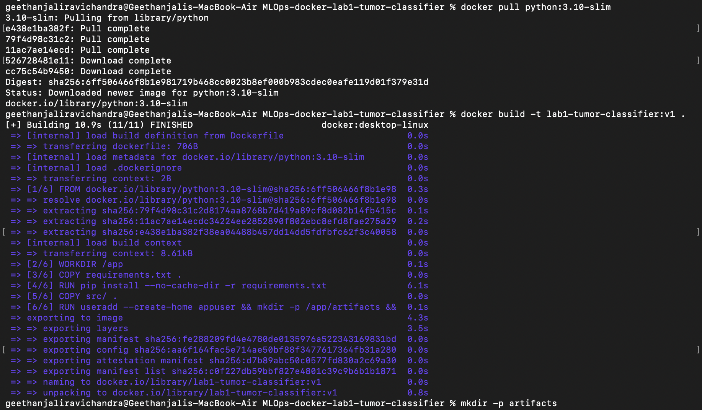
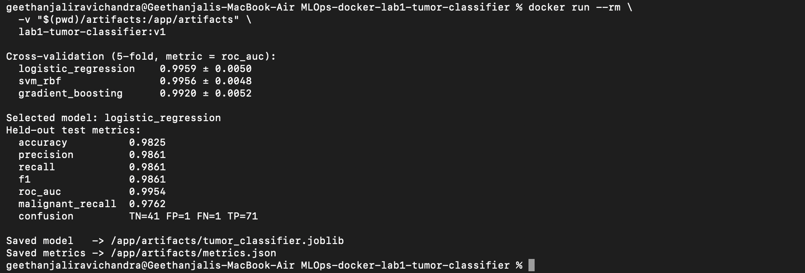

# Docker Lab 1 - Containerized Breast Cancer Tumor Classifier

## Overview

This project implements a machine learning application inside a Docker container to classify breast cancer tumors as **malignant or benign**.

The original lab uses the Iris dataset and a Random Forest classifier. I modified the project to use the Breast Cancer Wisconsin Diagnostic dataset and implemented a model training pipeline that compares multiple classifiers, selects the best-performing model, and evaluates it on a held-out test set.

The application runs inside a Docker container and saves the trained model and evaluation metrics as output artifacts.

## Modifications from the Original Lab

The following changes were made to the original implementation:

- **Dataset:** Replaced the Iris dataset with the Breast Cancer Wisconsin Diagnostic dataset, which contains 569 samples and 30 features.
- **Classification task:** Changed the task from Iris flower classification to binary classification of breast cancer tumors (malignant or benign).
- **Multiple models:** Implemented Logistic Regression, Support Vector Machine (RBF kernel), and Gradient Boosting classifiers.
- **Model selection:** Added 5-fold stratified cross-validation to compare the models and automatically select the best one based on ROC-AUC.
- **Preprocessing:** Added StandardScaler to the Logistic Regression and SVM pipelines.
- **Evaluation:** Added accuracy, precision, recall, F1-score, ROC-AUC, malignant recall, and confusion matrix evaluation.
- **Configuration:** Added environment-based configuration for test size, random seed, cross-validation folds, selection metric, and output directory.
- **Model artifacts:** Save the selected trained model as `tumor_classifier.joblib` and evaluation results as `metrics.json`.
- **Prediction:** Added a separate prediction script to load the saved model and make predictions.
- **Testing:** Added automated tests using pytest to validate configuration, data loading, model creation, training, evaluation, and artifact generation.
- **Dockerfile:** Updated the Dockerfile to use a lightweight Python image, install dependencies, run as a non-root user, and store generated artifacts in a mounted directory.

## Project Structure

```text
docker-lab1/
├── Dockerfile
├── .dockerignore
├── .gitignore
├── README.md
├── requirements.txt
├── requirements-dev.txt
├── src/
│   ├── config.py
│   ├── data.py
│   ├── models.py
│   ├── train.py
│   └── predict.py
├── tests/
│   ├── conftest.py
│   ├── test_config.py
│   ├── test_data.py
│   └── test_train.py
├── artifacts/
│   ├── tumor_classifier.joblib
│   └── metrics.json
└── assets/
    ├── docker-build.png
    └── docker-run.png
```

The `artifacts/` directory is generated when the container runs. The `assets/` directory contains screenshots of the Docker build and execution.

## Requirements

- Docker Desktop or Docker Engine
- Python 3.10 (for running locally)
- Git (optional, for cloning the repository)

## Build the Docker Image

From the project root directory, run:

```bash
docker build -t lab1-tumor-classifier:v1 .
```

This builds the Docker image using the provided Dockerfile and installs the required Python dependencies.

## Run the Docker Container

Create a local directory to store the generated artifacts:

```bash
mkdir -p artifacts
```

Run the container:

```bash
docker run --rm \
  -v "$(pwd)/artifacts:/app/artifacts" \
  lab1-tumor-classifier:v1
```

The container performs the following steps:

1. Loads the Breast Cancer Wisconsin dataset.
2. Splits the data into training and testing sets.
3. Trains and compares three classification models using 5-fold cross-validation.
4. Selects the best-performing model based on ROC-AUC.
5. Evaluates the selected model on the held-out test set.
6. Saves the trained model and evaluation metrics to the mounted `artifacts/` directory.

After execution, the generated files will be available locally:

```text
artifacts/
├── tumor_classifier.joblib
└── metrics.json
```

## Model Prediction

After training, the saved model can be used to make predictions.

Run:

```bash
docker run --rm \
  -v "$(pwd)/artifacts:/app/artifacts" \
  lab1-tumor-classifier:v1 \
  python predict.py 5
```

The command loads the saved model and displays predictions for five samples, along with their prediction confidence and actual labels.

## Screenshots

### Docker Build

The following screenshot shows the successful creation of the Docker image.



### Docker Training Run

The following screenshot shows the container running the training pipeline, comparing models, selecting the best model, evaluating its performance, and saving the generated artifacts.



## Configuration

The application supports configuration through environment variables.

| Variable | Default | Description |
|---|---|---|
| `TEST_SIZE` | `0.2` | Proportion of data reserved for testing |
| `RANDOM_SEED` | `42` | Random seed for reproducibility |
| `CV_FOLDS` | `5` | Number of cross-validation folds |
| `SELECTION_METRIC` | `roc_auc` | Metric used for model selection |
| `OUTPUT_DIR` | `artifacts` | Directory for saved model and metrics |

## Running Tests

To run the tests locally, create a virtual environment and install the development dependencies:

```bash
python -m venv .venv
source .venv/bin/activate
pip install -r requirements-dev.txt
```

Run the test suite:

```bash
pytest -v
```

The test suite contains 12 tests covering configuration validation, data loading, model creation, training, evaluation, prediction, and artifact generation.

**Test result:** 12 tests passed.

## Results

The following results were obtained from the successful Docker container execution.

### Cross-Validation Results

| Model | Mean ROC-AUC | Standard Deviation |
|---|---:|---:|
| Logistic Regression | 0.9959 | 0.0050 |
| SVM (RBF) | 0.9956 | 0.0048 |
| Gradient Boosting | 0.9920 | 0.0052 |

Logistic Regression was selected as the best-performing model based on the mean cross-validation ROC-AUC.

### Held-Out Test Results

| Metric | Score |
|---|---:|
| Accuracy | 0.9825 |
| Precision | 0.9861 |
| Recall | 0.9861 |
| F1-score | 0.9861 |
| ROC-AUC | 0.9954 |
| Malignant Recall | 0.9762 |

**Confusion Matrix:**

| | Predicted Malignant | Predicted Benign |
|---|---:|---:|
| Actual Malignant | 41 | 1 |
| Actual Benign | 1 | 71 |

These results demonstrate the model's performance on the selected dataset. They are for educational purposes only and should not be interpreted as clinical diagnostic performance.

## Save the Docker Image

To export the built Docker image as a tar file:

```bash
docker save lab1-tumor-classifier:v1 > lab1-tumor-classifier.tar
```

The image can later be loaded using:

```bash
docker load < lab1-tumor-classifier.tar
```

## Conclusion

This lab extends the original Iris classification example into a more complete machine learning application. It introduces multiple model comparisons, cross-validation-based model selection, evaluation metrics, automated tests, and model artifact generation.

The application is packaged and successfully executed inside Docker, with the trained model and evaluation results saved outside the container.